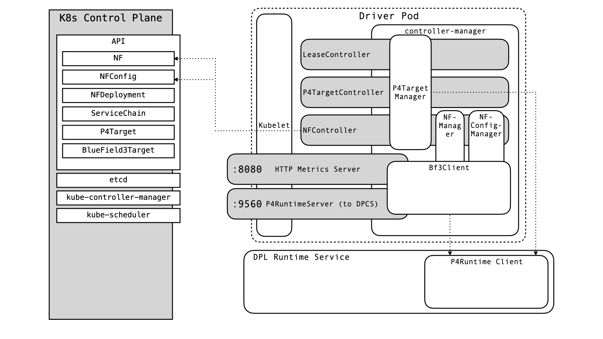
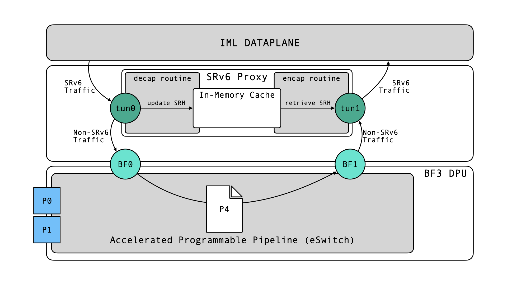
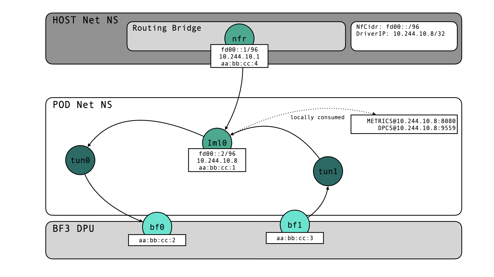
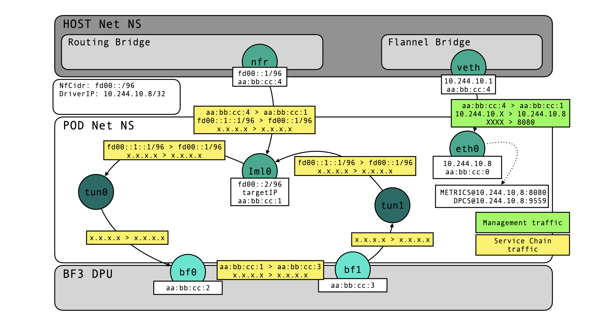

# Implementation of the BlueField 3 Plugin
This document provides a detailed overview over the Bluefield3-Plugin, its implementation details and configuration information. I accompanies the thesis document and provides details, which were inappropriate for the thesis itself.

- [Implementation of the BlueField 3 Plugin](#implementation-of-the-bluefield-3-plugin)
  - [Host Prerequisites](#host-prerequisites)
    - [DPL Compiler](#dpl-compiler)
    - [BlueField 3 Installation](#bluefield-3-installation)
    - [Additional](#additional)
  - [Controller Implementations](#controller-implementations)
    - [P4Target](#p4target)
    - [Bluefield3Target](#bluefield3target)
    - [NetworkFunction](#networkfunction)
    - [NetworkFunctionConfig](#networkfunctionconfig)
  - [SRv6 Proxy Implementation](#srv6-proxy-implementation)
    - [Known Limitations](#known-limitations)
  - [Networking](#networking)
    - [Control Traffic](#control-traffic)
    - [Service Chain Traffic](#service-chain-traffic)
    - [Networking Configuration Flow](#networking-configuration-flow)

## Host Prerequisites

### DPL Compiler
### BlueField 3 Installation
### Additional

## Controller Implementations

### P4Target
### Bluefield3Target
### NetworkFunction
### NetworkFunctionConfig

## SRv6 Proxy Implementation

The SRv6 Proxy implemented uses kernel routing, while performing the actual proxy tasks (reading, updating, caching of the SRH) in user space. Packets travel from kernel to user space via two TUN devices: `tun0` for decapsulating incoming SRv6 traffic and `tun1` for re-encapsulating traffic from the Bluefield.
We implement the dynamic proxy behavior $END.AD$ suggested in a [recent internet draft](https://datatracker.ietf.org/doc/draft-ietf-spring-srv6-service-programming/). Incoming packets are read and decapsulated. The SRH is updated (`segmentsLeft--`, `DA=segList[segmentsLeft]`) and stored in a cache. The return traffic is matched to the correct header (that is the correct service chain) based on the incoming interface (Bluefield -> Host). 
> Using fields from the packet itself can not work, since the network function can modify anything in the packet, or even drop it (e.g. Firewall/NAT).

We only implement the proxy for $n=1$ incoming interfaces, but scaling to more interfaces is possible to distinguish between different service chains at the same time. 
It is obvious that in the current implementation, encapsulating packets with a wrong header is possible. More on limitations [later](#known-limitations).
The decapsulation and encapsulation components are implemented as go routines, which share an in-memory cache and own the tun devices.
We use policy-based routing to ensure that traffic flows through the tun devices and return traffic is forwarded directly to the re-encapsulation component instead of being routed normally. More details on the actual implementation is [here](#service-chain-traffic).
### Known Limitations
The current implementation suffers from several limitations, which could not be solved in the time of this thesis, which focuses not on SRv6 proxying, but a hardware driver for IML.
Firstly, traffic, which is still in transit when a new header is cached will be encapsulated with the new header incorrectly. 
One could lower the probability of misclassification of return traffic by adding more outgoing and incoming interfaces. Suppose, we had four interfaces `in0`, `in1`, `out0`, `out1` ($n=2$) instead of two. The decapsulation component could then cache two different headers, representing two different service chains. Packets belonging to chain A would be emitted on `in0` and packets in service chain B on `in1`. The encapsulation component could then distinguish service chains based on whether they arrive on `out0` or `out1` (e.g. -> use header stored at cache[1]). Note, that for this to work, the P4 program needs to maintain a mapping `INPORT -> OUTPORT`, which aligns with the proxy convention.
This would also require the decapsulation component to choose an eviction strategy: when two headers are cached and a third one arrives, one header needs to be evicted.
While this would allow more packets from different service chains in transit at the same time, it would also complicate the implementation and require more time than we had.
This is also true for implementations using DPDK or FD.io, since IML relies heavily on kernel networking. Moving more parts to user-space using specialized libraries would most likely yield performance gains. This, again, was not the priority here. We aimed at finding a solution simply integrated with IML to showcase the feasibility of this thesis' project.
## Networking
We need to provide reachability for different types of traffic necessary for Loom functionality.
One kind of traffic is management/control traffic, which includes the gRPC DPCS and HTTP Metrics scraping. These should be reachable under a driver IP assigned by the operator, e.g. at `<driver-ip>:9559` and `<driver-ip>:8080`.
Other traffic is service chain traffic, which is in the SRv6 domain. Under the restrictions described above, we implement a SRv6 proxy to allow temporarily exiting the SRv6 domain while maintaining the source routing capabilities.
We assume the following topology: the net ns of the BlueField driver pod is connected to the host net ns through a veth-pair (`nfr-<random> <--> iml0`). The bridge is the gateway for control and service chain traffic alike, that is not destined for pod-local endpoints (which are the local metrics and DPCS endpoints, and the network function deployed on the Bluefield which the driver manages).
We move two additional interfaces into the pod net ns: one interface for traffic entering the DPL pipeline and one to receive return traffic from it. They can represent physical, virtual, and scalable functions, but we name them `bf0` and `bf1` for consistency.
> DPL does not allow reflecting packets back on the port they were received on, otherwise one interface would suffice.
### Control Traffic
Control traffic is bound to a particular CIDR, the driver gets an IP in the management subnet to enable DPCS etc.. L2 Traffic received on `iml0` (which will have IP addresses in all subnets, which are reachable in the pod) will be consumed and passed to L3. Control traffic endpoints will be addressed by a local IP address. The kernel sees this and delivers the packet to higher layers for DPCS or else to consume it. Return traffic will use a default route to the Gateway bridge (whose IP is distributed from the CNI) IP via the `iml0` interface.
### Service Chain Traffic
Service chain traffic is a little bit more complex, since the proxy needs to be integrated. Traffic can not deviate between decapuslation at `tun0` and re-encapsulation at `tun1`. Traffic destined for the network function arrives at `iml0`, which has an IP in the NfCidr assigned to the target. It terminates L2 traffic and passes the SRv6 packet to the kernel for routing. The kernel needs a route to pass packets addressed to the NF on the DPL switch to `tun0` and forward other SRv6 packets to the gateway through `iml0`. The SRv6 packet arrives at `tun0`, whose owning go routine performs decapsulation, updates and caches the header. Afterwards, it writes the packet back to `tun0`. The kernel receives the decapsulated packet on `tun0`, which matches an ip rule (configured for IPv4 and IPv6 to ensure that both inner IP types are supported) causing a route lookup in another routing table (e.g. `from all iif tun0 lookup 200`). This routing table needs a default route, which will transmit an L2 frame out of `bf0`. We configure a static mac address (the mac of `bf1`to be specific) on a bogus gateway IP to enable L2 transmission. Otherwise the DPL pipeline would have to participate in ARP to resolve the destination mac address. The default route in the lookup table is the something like: `default via <bogus-ip> dev bf0`.
The kernel receives the L2 return traffic from the Bluefield pipeline on `bf1`. We provide a rule matching on `iif bf1` and push the L3 packet directly to `tun1`.
> No static mac address needed here, because the tun device is not receiving L2 traffic.

`tun1` performs re-encapsulation (for discussion of the restrictions see above) and writes the SRv6 traffic back to the tun device. The kernel's IP stack receives the SRv6 traffic from `tun1` and routes it based on the (updated) outer destination address. The route established above will send the traffic to the gateway out of `iml0`. To construct L2 frames, the mac address of the bridge (DA) and mac address of the `iml0` interface (SA) are used.

Traffic will flow like this:

### Networking Configuration Flow
When the driver pod is created, Multus sends ADD requests to the primary (e.g. flannel) and secondary (IML) CNI.
The primary CNI assigns a pod IP in the node's PodCIDR (e.g. 10.244.0.0/24 for flannel). The IML CNI does additional configuration, that is performing actions which require configuration of the host net namespace.
The IML CNI could be extended to react to a new AppType (e.g. `HostAttachedTarget`) taking arguments such as `MoveInterfaces` (specifying interfaces (to expose VFs (SR-IOV) or SFs directly to the pod) to be moved into the pod namespace).
The CNI would take care of necessary host net ns configurations and allocation and assignment of IP addresses, including:
- fetching P4Target `NetConfig` object from the CNI server (IML daemon)
  > The `NetConfig` object contains information on: the dual stack IPs to assign to `iml0`, the IPv6 cluster CIDR, the dual stack Gateway IPs (the IPs of the routing bridge), the name of the routing bridge, the name of the veth-peer connected to `iml0`, and the supported MTU.
- creating a veth pair to connect the pod to the routing bridge (move veth-peer `iml0` to pod net ns)
- assigning the `NetConfig.IPNet` (TargetIP) to `iml0`
- moving all interfaces specified by `MoveInterfaces` into the pod namespace
- setting the network annotations `k8s.v1.cni.cncf.io/network-status` 
  
Then the pod starts and `driver/main.go` runs, where the driver IP can be discovered from the corresponding interface. The address can be used to bind DPCS and a metrics server.
The `NfCidr` (IPv6 CIDR to allocate IPs for network functions on the target) is allocated by the P4Target controller in the IML operator. The driver's P4TargetController waits for this assignment to happen.
For now, I'll configure the network after the `NfCidr` has been allocated.

With the relevant information acquired, the P4TargetManager can ensure the following configurations:
- create default routes via the gateways provided in the `NetConfig` object (IPv4/IPv6)
  - `<clusterCIDR> via <Gateway> dev iml0`
- publish the driverIP + targetIP (`NetConfig.IPNet`) in P4Target Resource
- create proxy configuration
  - create TUN devices `tun0`, `tun1`
  - allocate and assign IP in `NfCidr` to `iml0` (or IPNet from `NetConfig`) 
  - create routes (IPv6) to forward traffic directed to the target IP to `tun0`
  - create rules for `tun0`->`bf0` + `bf1`->`tun1`
