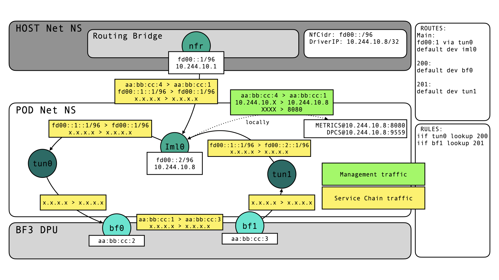

# Implementation of the BlueField 3 Plugin

## Host Prerequisites

### DPL compiler
### BlueField 3 Installation
### Additional

## Controller Implementations
### P4Target
### Bluefield3Target
### NetworkFunction
### NetworkFunctionConfig

## Proxy Implementation
### Known weaknesses

## Networking
We need to provide reachability for different types of traffic necessary for Loom functionality.
One kind of traffic is management/control traffic, which includes the gRPC DPCS and HTTP Metrics scraping. These should be reachable under a driver IP assigned by the operator, e.g. at `<driver-ip>:9559` and `<driver-ip>:8080`.
Other traffic is service chain traffic, which is in the SRv6 domain. Under the restrictions described above, we implement a SRv6 proxy to allow temporarily exiting the SRv6 domain while maintaining the source routing capabilities.
We assume the following topology: the net ns of the BlueField driver pod is connected to the host net ns through a veth-pair (`nfr-<random> <--> iml0`). The bridge is the gateway for control and service chain traffic alike, that is not destined for pod-local endpoints (which are the local metrics and DPCS endpoints, and the network function deployed on the Bluefield which the driver manages).
We move two additional interfaces into the pod net ns: one interface for traffic entering the DPL pipeline and one to receive return traffic from it. They can represent physical, virtual, and scalable functions, but we name them `bf0` and `bf1` for consistency.
> DPL does not allow reflecting packets back on the port they were received on, otherwise one interface would suffice.
### Control Traffic
Control traffic is bound to a particular CIDR, the driver gets an IP in the management subnet to enable DPCS etc.. L2 Traffic received on `iml0` (which will have IP addresses in all subnets, which are reachable in the pod) will be consumed and passed to L3. Control traffic endpoints will be addressed by a local IP address. The kernel sees this and delivers the packet to higher layers for DPCS or else to consume it. Return traffic will use a default route to the Gateway bridge (whose IP is distributed from the CNI) IP via the `iml0` interface.
### Service Chain Traffic
Service chain traffic is a little bit more complex, since the proxy needs to be integrated. Traffic can not deviate between decapuslation at `tun0` and re-encapsulation at `tun1`. Traffic destined for the network function arrives at `iml0`, which has an IP in the NfCidr assigned to the target. It terminates L2 traffic and passes the SRv6 packet to the kernel for routing. The kernel needs a route to pass packets addressed to the NF on the DPL switch to `tun0` and forward other SRv6 packets to the gateway through `iml0`. The SRv6 packet arrives at `tun0`, whose owning go routine performs decapsulation, updates and caches the header. Afterwards, it writes the packet back to `tun0`. The kernel receives the decapsulated packet on `tun0`, which matches an ip rule (configured for IPv4 and IPv6 to ensure that both inner IP types are supported) causing a route lookup in another routing table (e.g. `from all iif tun0 lookup 200`). This routing table needs a default route, which will transmit an L2 frame out of `bf0`. We configure a static mac address (the mac of `bf1`to be specific) on a bogus gateway IP to enable L2 transmission. Otherwise the DPL pipeline would have to participate in ARP to resolve the destination mac address. The default route in the lookup table is the something like: `default via <bogus-ip> dev bf0`.
The kernel receives the L2 return traffic from the Bluefield pipeline on `bf1`. We provide a rule matching on `iif bf1` and push the L3 packet directly to `tun1`.
> No static mac address needed here, because the tun device is not receiving L2 traffic.

`tun1` performs re-encapsulation (for discussion of the restrictions see above) and writes the SRv6 traffic back to the tun device. The kernel's IP stack receives the SRv6 traffic from `tun1` and routes it based on the (updated) outer destination address. The route established above will send the traffic to the gateway out of `iml0`. To construct L2 frames, the mac address of the bridge (DA) and mac address of the `iml0` interface (SA) are used.

Traffic will flow like this:

